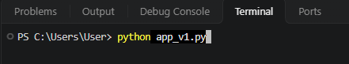
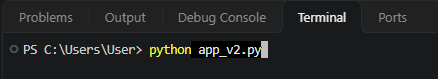
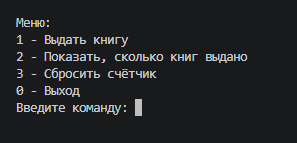
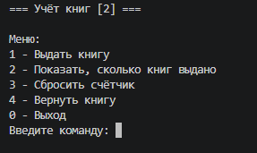

# Учёт книг

## Описание

Программа: для выдачи и возвращения книг из библиотеки

## Файлы

- app_v1.py - Первая версия программы,
- app_v2.py - Вторая версия программы,
- otchet.md - таблица отчёта.

## Инструкция по запуску

Запустить Visual Studio Code [еслу нету установить]. В терминале написать "python app_v1.py"

В терминале написать "python app_v2.py" для второй версии

## Как пользоватся

1. Для выдачи книги нажмите 1
2. Для просмотра количества выданных книг нажмите 2
3. Для сброса счётчика книг нажмите 3
4. Для возвращения книги обратно нажмите 4 (в версии 2)
5. Для завершения работы нажмите 0

## Первая программа

## Вторая программа

### Выполнил

## Аймалетдинов Тимофей 11ТЭС-26